# Quantum Annealing for Seismic Finite-Difference Coefficient Optimization

[](https://www.python.org/)
[](LICENSE)
[](https://docs.ocean.dwavesys.com/)

Seismic imaging depends on finite-difference (FD) simulations of wave propagation, and their accuracy depends on the FD stencil coefficients. [Wen & Wang (2025)](https://doi.org/10.1029/2024JH000473) showed that these coefficients can be optimized iteratively on a quantum annealer by turning each linear solve into a QUBO (quadratic unconstrained binary optimization) problem.

This repository reproduces their method end to end on a classical simulated-annealing (SA) backend and maps where it works and where it breaks across 1D, 2D and 3D. It then finds a flaw in the objective the method optimizes, and fixes it. With coefficients designed to minimize the actual waveform error of a travelling pulse, pulses stay accurate 1.46× farther in 1D at the paper's setting (at least 7.6× with a narrower source band) and 11–14% farther in the worst direction in 2D/3D. The same annealing pipeline finds these coefficients in every run.

<p align="center">
  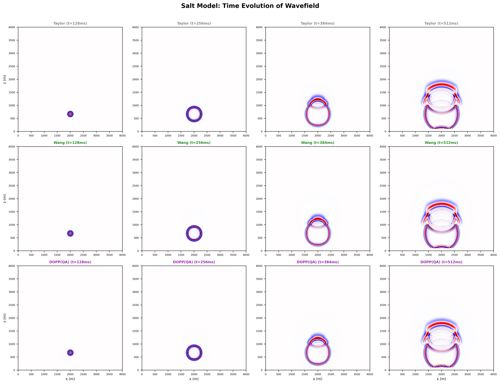
</p>
<p align="center"><sub>2-D acoustic wavefield in a synthetic salt model at four times, simulated with FD coefficients from a Taylor expansion (top), Wang's classical optimizer (middle) and DOPP(QA), Nelder–Mead on the dispersion error seeded from a QA solution (bottom). Generated by <code>experiments/Paper_Forward_Simulations.py</code>.</sub></p>

> **Context.** Research project, spring 2026, B.Tech. Data Science & AI, IIT Roorkee. By Samyak Ajmera and Pratham Patel, supervised by Prof. Simanchal Padhy. Published to GitHub in October 2026. The method and the solver library in `core/` are by Wen & Wang ([details](#credits-and-license)). The experiments, extensions and analysis are ours.

## Highlights

- **Main result: fixing the objective.** The objective that both the classical method and QA minimize lets errors in different directions cancel, samples only 15 wavenumbers, and doesn't keep low frequencies accurate. We derived an exact formula for the waveform error of a travelling pulse; it matches real time-stepping simulation to three significant figures. We then designed coefficients to minimize that error, subject to consistency and stability constraints.
  - Pulses stay accurate (≤10% waveform error) **1.46× farther in 1D** at the paper's setting, and **at least 7.6× farther** with a narrower source band.
  - In 2D/3D they go **11–14% farther in the worst direction**.
  - These comparisons use directions never seen during design, against the classical method with its design band tuned for each source.
  - The paper's annealing pipeline solves the new objective: **all 18 annealing runs match the classical optimum**. [→](#n5-fixing-the-objective-waveform-optimized-coefficients)
- **Reproduction on a classical backend.** With the quantum processor replaced by simulated annealing, the best of 3 QA runs matches the classical solver's objective to 4+ significant figures in 4 of 6 1D configurations and beats it in one. It comes within 1.3–1.4× in 2D (high velocity) and 3D. It fails in the 2D low-velocity case (1,659× worse). [→](#r-reproduction)
- **The binary encoding is the main deployment risk.** In 1D, any encoding with R ≥ 6 bits works. In 2D and 3D, the final objective swings by up to 6 orders of magnitude across encodings, and not monotonically in R. [→](#s-encoding-sensitivity)
- **QA → classical hybrid.** A short QA phase followed by classical polishing lands exactly on the classical solution in 2D and 3D. That is 3.7× lower than QA alone in 3D, with run-to-run variation at floating-point level. [→](#n1-qa--wang-two-stage-hybrid)
- **Condition-number-adaptive regularization.** Setting the regularization weight from the Jacobian's condition number brings standalone QA to the classical result in 3D (1.01×) and cuts its run-to-run spread ~230×. [→](#n2-condition-number-adaptive-regularization-cnar)
- **Negative results, documented.** Averaging the top-K samples, momentum on the step size, greedy rollback and multi-restart all fail to help consistently across dimensions. [→](#n3-what-did-not-work)
- **A cautionary result that led to the main one.** Nelder–Mead on the reported dispersion metric, seeded from a pool of QA solutions, cut that metric by 59% in 1D. But the gain came from frequencies the source doesn't contain. A real simulation shows waveform error after 10 km rising from 2% to 37%. [→](#caveat-where-the-gain-comes-from)

## Background

### The problem: numerical dispersion

A staggered-grid FD scheme approximates a spatial derivative with $M$ coefficients $a_1,\dots,a_M$:

$$\frac{\partial p}{\partial x}\bigg|_{i+1/2} \approx \frac{1}{h}\sum_{m=1}^{M} a_m\,\big[p_{i+m} - p_{i-m+1}\big]$$

With Taylor-series coefficients, high-wavenumber waves travel at the wrong speed (*numerical dispersion*), which smears and distorts wavefronts. Dispersion-preserving methods choose $\mathbf a$ so that the numerical phase velocity matches the true one over a band of wavenumbers. Quality is measured by the phase-velocity ratio $\sigma(kh)$ (numerical / true, ideally 1) over the normalized wavenumber $kh \in (0, \pi]$:

| Metric | Definition | Role |
|---|---|---|
| $\Phi$ | Squared residual of the dispersion relation, summed over the *design band* $kh \le kh_{\max}$ (set by the source's maximum frequency, $\approx 0.77\pi$–$0.8\pi$ here) and over propagation directions | The objective both solvers minimize |
| $\sigma_{\text{MAE}}$ | Mean $\lvert\sigma - 1\rvert$ over the *full* range $kh \in (0,\pi]$ and 1 (1D), 4 (2D) or 5 (3D) directions | Reported dispersion error |

### The method being reproduced

Wang et al. (2014) minimize $\Phi$ with Gauss–Newton-style iterations. Each iteration linearizes the dispersion residual around the current coefficients, solves a Tikhonov-regularized least-squares problem for the update, and shrinks the regularization weight $\alpha$ tenfold. Wen & Wang (2025) replace that linear solve with quantum annealing:

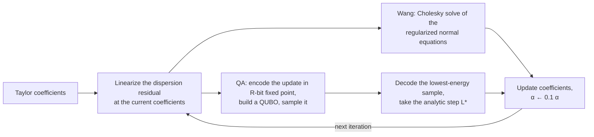

The analytic step size $L^*$ is the exact line-search step along the decoded direction. It also sets the encoding range of the next QUBO, so precision adapts as the iterates converge.

**Settings used here** (all experiments, unless stated otherwise):
- Sampler: D-Wave's classical `neal` sampler, 100 reads × 1,000 sweeps per QUBO, lowest-energy sample.
- Encoding: R = 10 bits, binary point fp = 1. Up to 3 QUBO solves per outer iteration.
- Regularization: α₀ = 1, decayed 10× per iteration.
- Iterations: 20 outer iterations (1D/2D) or 30 (3D), starting from Taylor coefficients.

No quantum-processor time was used, so nothing here says anything about quantum speedup.

## What we added

| | Study | Idea | Script(s) |
|---|---|---|---|
| R | Reproduction | Re-run the paper's 1D/2D/3D configurations on SA | `Reproduction_Corrected.py` |
| S | Encoding sensitivity | Sweep the bit count R and binary point fp | `Encoding_Sensitivity_Study.py`, `Multidim_Ablations_and_Novelty.py` |
| N1 | QA → Wang hybrid | QA explores first, then Wang's method polishes | `Novelty_QA_to_Wang_Stabilization.py` |
| N2 | CNAR | Set α from the condition number κ of the linearized system (4 strategies) | `CNAR_Improved_Study.py` |
| N3 | Ablations | ESE (top-K sample averaging), momentum on L\*, greedy revert, multi-restart | `ESE_CNAR_Novelty_Study.py`, `Novelty_Ablation_Experiments.py` |
| N4 | QDP + DOPP | Pool of QA runs → keep best σ_MAE → Nelder–Mead on σ_MAE | `Dispersion_Optimized_Novelty.py`, `Band_Analysis.py` |
| N5 | Waveform-optimized design | Minimize the exact waveform error of a travelling pulse per direction, with consistency and stability constraints; solve classically and with the annealing pipeline | `Waveform_Optimized_Design.py` |
| V | Wave simulations | 2-D forward modelling in homogeneous and salt models | `Paper_Forward_Simulations.py`, `DOPP_Forward_Waveform.py` |

## Results

QA results are stochastic and no random seeds were fixed. Tables report the mean over *n* independent runs unless stated otherwise; Wang's method is deterministic. Per-run data is in [`results/`](results).

### R. Reproduction

Final objective Φ (lower is better). *n* = 3 QA runs per configuration ([`results/reproduction_corrected.csv`](results/reproduction_corrected.csv)).

| Dim | v (m/s) | M | Wang | QA, best of 3 | QA, mean of 3 | Best ÷ Wang |
|---|---:|---:|---:|---:|---:|---:|
| 1D | 1500 | 4 | 2.14e-5 | 2.14e-5 | 2.14e-5 | 1.00 |
| 1D | 1500 | 6 | 2.23e-7 | 2.23e-7 | 2.23e-7 | 1.00 |
| 1D | 1500 | 8 | 2.38e-9 | 2.18e-9 | 4.78e-9 | **0.92** |
| 1D | 4500 | 4 | 1.26e-5 | 1.26e-5 | 1.26e-5 | 1.00 |
| 1D | 4500 | 6 | 1.31e-7 | 1.31e-7 | 1.31e-7 | 1.00 |
| 1D | 4500 | 8 | 1.53e-9 | 4.99e-9 | 6.68e-9 | 3.27 |
| 2D | 1500 | 10 | 3.74e-10 | 6.20e-7 | 8.89e-5 | **1,659** |
| 2D | 4500 | 10 | 2.29e-8 | 3.12e-8 | 8.44e-8 | 1.36 |
| 3D | 2500 | 10 | 1.65e-8 | 2.15e-8 | 9.02e-8 | 1.31 |

<sub>Grid: h = 10 m (1D, 3D) or 20 m (2D); time step 1 ms; maximum frequency 58 / 174 Hz (1D), 29 / 90 Hz (2D), 100 Hz (3D).</sub>

In dispersion-error terms, the best QA run is within 1.2% of Wang's σ_MAE in every configuration except 2D low-velocity (2.2× worse). The mean of three runs is 1.3–4× the best run (143× in 2D low-velocity). That gap is the practical cost of stochastic sampling.

<p align="center">
  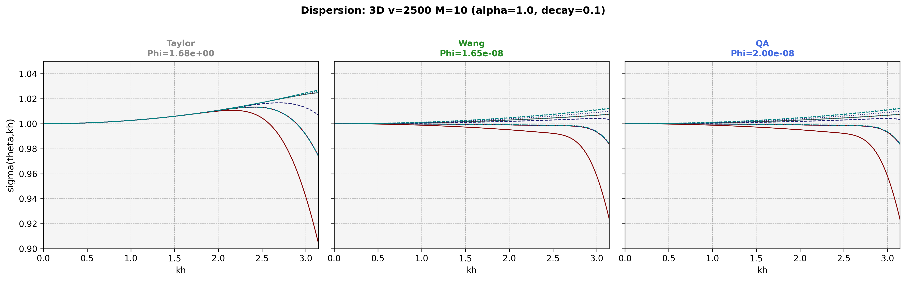
</p>

Regularization matters. In the upstream regularization experiment (`Algorithm_Optimization.ipynb`, re-run here), many unregularized QA runs stall around Φ ≈ 0.1–1. The regularized runs converge faster, and most reach ~1e-9 within 20 iterations ([`figures/reproduction/regularization_convergence.png`](figures/reproduction/regularization_convergence.png)).

### S. Encoding sensitivity

Each coefficient update is encoded with R bits and binary point fp, covering roughly [−2^fp, 2^fp) at a resolution of 2^(fp−R+1). The 3D results below are a single run per cell with 20 outer iterations ([`results/encoding_sensitivity_dim3_summary.csv`](results/encoding_sensitivity_dim3_summary.csv)):

| 3D: final Φ | R = 6 | R = 10 | R = 12 |
|---|---:|---:|---:|
| fp = 0 | 5.7e-4 | 2.1e-8 | 2.1e-8 |
| fp = 1 | 1.3e-3 | 1.2e-6 | 1.8e-6 |
| fp = 2 | 1.1e-2 | 1.2e-7 | 1.7e-8 |

- **1D** (R = 4…14, fp = 0…2): every setting with R ≥ 6 finishes within 2.6× of the best one. Only R = 4 fails.
- **2D**: final Φ ranges from 2.3e-8 to 3.1e-3, and it is not monotonic in R. With fp = 1, Φ is 1.6e-7 at R = 10 but 4.8e-4 at R = 12.
- **3D**: final Φ ranges from 1.7e-8 to 1.1e-2.

Encoding parameters validated in 1D therefore cannot be carried over to higher dimensions. That matters on real annealers, where the number of qubits limits R.

<p align="center">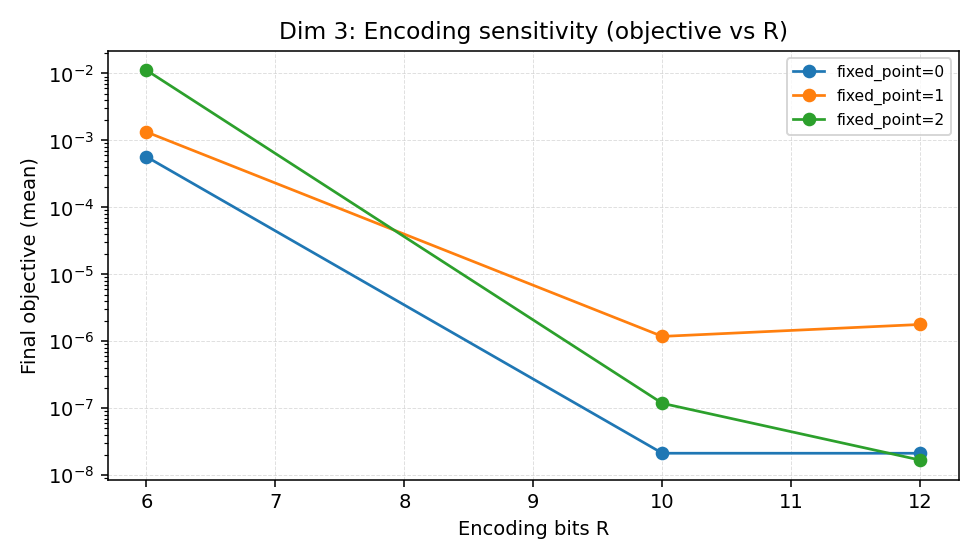</p>

### N1. QA → Wang two-stage hybrid

QA's iterates stay noisy near convergence, while Wang's method converges precisely but only locally. In the hybrid, QA runs for 8 iterations (12 in 3D), then Wang's method polishes for the rest of the 20-iteration budget (30 in 3D). Mean of *n* = 3 ([`results/novelty_qa_to_wang_summary.csv`](results/novelty_qa_to_wang_summary.csv)):

| Dim | QA only | QA → Wang | Wang only | Hybrid vs QA only | Hybrid runtime | Wang runtime |
|---|---:|---:|---:|---:|---:|---:|
| 1D | 4.49e-9 | 2.63e-9 | 1.53e-9 | 1.7× lower | 7.6 s | 0.05 s |
| 2D | 2.34e-8 | 2.29e-8 | 2.29e-8 | 1.02× lower | 20.8 s | 6.7 s |
| 3D | 6.10e-8 | 1.65e-8 | 1.65e-8 | **3.7× lower** | 39.8 s | 9.5 s |

In 2D and 3D, all three hybrid runs end on Wang's solution (run-to-run standard deviation ~1e-19). In 1D, the 12 polishing iterations are not enough to close the gap.

**Interpreting this honestly:** the hybrid makes an annealer-based pipeline reliable. But in this setting Wang's method alone reaches the same answer 3–4× faster, so the hybrid is a way to de-risk a QA pipeline, not a better optimizer.

### N2. Condition-number-adaptive regularization (CNAR)

A fixed α₀ = 1 ignores how ill-conditioned the linearized system is. The condition number κ = cond(AᵀA) ranges from about 10⁴ to 10⁶ across dimensions. CNAR sets α = 0.1·max(0, log₁₀κ − 4) and decays it by 0.7 per iteration. The four variants differ in when κ is computed:

- **A:** κ computed once at the start.
- **B:** κ recomputed every iteration.
- **C:** α = 0.1·log₁₀κ / 10, with no threshold.
- **D:** B combined with top-3 sample averaging.

Mean of *n* = 3 ([`results/cnar_improved_summary.csv`](results/cnar_improved_summary.csv)):

| Dim | QA baseline | A | B | C | D | Wang |
|---|---:|---:|---:|---:|---:|---:|
| 1D | 4.5e-9 | 4.3e-9 | 4.8e-9 | **4.0e-9** | 6.4e-9 | 1.5e-9 |
| 2D | 1.1e-6 | **1.4e-7** | 1.0e-6 | 3.3e-5 | 7.6e-5 | 2.3e-8 |
| 3D | 5.9e-8 | 5.3e-7 | **1.67e-8** | 3.0e-8 | 1.7e-4 | 1.65e-8 |

- **3D:** per-iteration CNAR (B) matches Wang (1.01×), and its run-to-run standard deviation drops from 5.6e-8 to 2.4e-10.
- **2D:** strategy A improves QA 7.7× but stays 6× above Wang.
- **1D:** the differences are within run-to-run noise (standard deviation ≈ 2e-9).

No single strategy wins in every dimension.

### N3. What did not work

**Ensemble sample exploitation (ESE).** This replaces the lowest-energy sample with a Boltzmann-weighted average of the top-K samples. Mean of *n* = 5 ([`results/ese_summary_final.csv`](results/ese_summary_final.csv)):

| K | 1D | 2D | 3D |
|---|---:|---:|---:|
| 1 (original) | 5.3e-9 | **5.0e-8** | **2.9e-6** |
| 3 | 5.3e-9 | 7.7e-6 | 1.6e-4 |
| 5 | 5.1e-9 | 1.8e-4 | 4.7e-5 |
| 10 | 5.7e-8 | 7.3e-5 | 1.8e-3 |

In 1D, K = 3 and K = 5 change nothing beyond noise, and K = 10 is ~10× worse. In 2D and 3D, every K > 1 makes the final objective 16–3,700× worse.

**Update-rule changes.** Ratio of the final objective to unmodified QA, mean of *n* = 5 ([`results/novelty_ablation_summary.csv`](results/novelty_ablation_summary.csv), 12 variants in total):

| Variant | 1D | 2D | 3D |
|---|---:|---:|---:|
| Momentum on L* (β = 0.5) | 105× worse | 14× better | 14× worse |
| Greedy revert (roll back when Φ rises) | 1.04× worse | 1.4× better | 3.3× worse |
| Multi-restart (2 × 10 iterations, keep best) | 21× worse | 6.9× worse | 9.6× worse |

None of these heuristics generalizes across dimensions.

### N4. Optimizing the dispersion error directly (QDP + DOPP)

> **Short version:** this cuts the reported metric by up to 59%, but it makes real waveforms *less* accurate. Working out why led to N5.

Wang's method and QA both minimize Φ, a smooth L2 objective that can be linearized and written as a QUBO. The reported error, σ_MAE, is an L1-type metric over the full wavenumber range, and it has no QUBO form. Two ideas:

- **QA Diversity Pool (QDP):** run QA N times (N = 10 in 1D, 8 in 2D, 6 in 3D) and keep the run with the lowest σ_MAE.
- **Dispersion-Optimized Post-Processing (DOPP):** run gradient-free Nelder–Mead on σ_MAE, starting from a given coefficient vector. The *full pipeline* starts DOPP from the QDP winner.

Change in σ_MAE relative to Wang (negative is better). Means over *n* = 5 (1D) or 3 (2D, 3D) runs; Wang and DOPP(Wang) are deterministic ([`results/dispersion_novelty_summary.csv`](results/dispersion_novelty_summary.csv)):

| Method | 1D | 2D | 3D |
|---|---:|---:|---:|
| Wang (σ_MAE) | 0.00499 | 0.00231 | 0.00351 |
| QA, single run | −1.1% | +2.4% | +9.2% |
| QDP (best of pool, no polishing) | −6.6% | −8.3% | −7.1% |
| DOPP(Wang) | −52.3% | −11.3% | −12.6% |
| DOPP(QA) | −55.6% | −15.2% | −10.4% |
| **Full pipeline (QDP → DOPP)** | **−58.9%** | **−25.0%** | **−24.6%** |
| *Φ: full pipeline (Wang)* | *3.0e-5 (1.5e-9)* | *5.3e-3 (2.3e-8)* | *4.2e-2 (1.6e-8)* |

Most of the reduction comes from changing the objective. DOPP started from Wang's deterministic solution already gets 52% in 1D and 11–13% in 2D and 3D. Seeding DOPP from the best of a pool of QA runs adds a little in 1D (58.9% vs 52.3%) and roughly doubles the gain in 2D and 3D (about 25% vs 11–13%).

#### Caveat: where the gain comes from

σ_MAE averages the error over the full range kh ∈ (0, π]. About a fifth of that range lies above the design band, where every scheme's error is largest and where a source limited to the design frequency puts little energy. [`experiments/Band_Analysis.py`](experiments/Band_Analysis.py) splits the error by region and, in 3D, re-evaluates it on directions DOPP never optimized ([`results/band_analysis.csv`](results/band_analysis.csv); the full pipeline is a single run):

| Full pipeline vs Wang | 1D | 3D (5 optimized directions) | 3D (76 held-out directions) |
|---|---:|---:|---:|
| σ_MAE over the full band | −58% | −17% | −8% |
| Mean error *inside* the design band | **11.5× higher** | 1.1× higher | **41% higher** |
| Mean error *above* the design band | −66% | −34% | n/a |
| Bandwidth with error ≤ 10⁻³ | −25% | −25% | n/a |

DOPP buys its full-band improvement above the design band and gives up accuracy inside it. Accordingly, Φ, the in-band objective over all design directions, rises 10⁴–10⁶×. A real 1D time-stepping simulation shows the cost: after 10 km, the waveform error is 37% with DOPP(Wang) coefficients versus 2% with Wang's ([N5](#n5-fixing-the-objective-waveform-optimized-coefficients)). The ripples are visible below: compare Wang's flat curve with DOPP's. Whether that trade pays off depends on the source spectrum. Treat N4 as evidence that the choice of metric changes the answer, not as a strictly better set of coefficients.

<p align="center">
  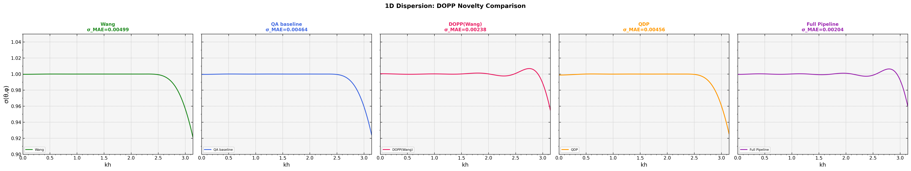
</p>

### N5. Fixing the objective: waveform-optimized coefficients

**What's wrong with Φ.** The objective that Wang's method and QA minimize (`core/stagger_FD_coeff.py`) has three problems:
- **Directions can cancel.** In 2D and 3D it sums the dispersion relation over directions *before* taking the residual, so a direction where waves run too fast can cancel one where they run too slow. In 3D the sum covers only 20 directions, all along the diagonal θ = φ.
- **Sparse sampling.** It samples only 15–16 wavenumbers.
- **Weak low-frequency control.** Fitting the *squared* relation down-weights low wavenumbers by roughly kh². The resulting coefficients miss σ(0) = 1 by 1.3–3.1×10⁻⁴.

**What matters instead.** A simulation needs a band-limited pulse to arrive with the right shape. Take a plane-wave pulse with spectrum F(κ) that travels D grid points in direction d. Every Fourier component picks up the phase error κ·D·(σ(κ, d) − 1), so the relative waveform error is exactly

$$e(D, d)^2 = \frac{\sum_\kappa |F(\kappa)|^2 \, 4\sin^2\big(\kappa D\,(\sigma(\kappa, d) - 1)/2\big)}{\sum_\kappa |F(\kappa)|^2}$$

This formula agrees with real leapfrog time stepping to within 0.3% ([`results/waveform_timestep_check.csv`](results/waveform_timestep_check.csv)). For example, 0.3741 vs 0.3741 for DOPP and 0.0198 vs 0.0198 for Wang after 1,000 grid points.

**The new design.** Minimize Σ_d Σ_κ w(κ)² κ² (σ(κ, d) − 1)² over the source band and a set of training directions, where w is the Ricker spectrum floored at 5%. Two constraints apply:
- **Consistency:** σ(0) = 1, i.e. Σ(2m − 1)aₘ = 1.
- **Exact von Neumann stability:** r·√d·max|S| ≤ 0.95.

This is still a nonlinear least-squares problem, so the paper's own pipeline can solve it:
- a Gauss–Newton outer loop;
- each linearized step solved as a QUBO by the original annealing solver, with the same settings;
- consistency built in by solving in the constraint's null space;
- a step accepted only if it lowers the true objective and keeps the scheme stable.

**Protocol.**
- Directions are split: 2D/3D are evaluated on 42/44 held-out directions never used in design.
- **Metric:** accurate travel distance, the largest distance with ≤10% waveform error.
- Every method gets the same information, the source band. The Wang baseline is the best of three variants: the paper's band, the source band, and its design band tuned per source over 11 candidates.
- Two source bands are tested: the paper's (≈2.5 grid points per shortest wavelength) and a narrower, more typical one at 60% of it (≈4.2 points).

Accurate travel distance in grid points, worst held-out direction, design source ([`results/waveform_design_raw.csv`](results/waveform_design_raw.csv)):

| Dim | Source band | Wang (best variant) | Ours, classical | Ours, annealing (3 runs) | Gain |
|---|---|---:|---:|---:|---:|
| 1D | paper's | 8,573 | 12,503 | 12,496–12,504 | **1.46×** |
| 1D | 60% | 6,555 | ≥50,000 | ≥50,000 | **≥7.6×** |
| 2D | paper's | 61 | 69 | 69 | +13% |
| 2D | 60% | 283 | 323 | 323 | +14% |
| 3D | paper's | 36 | 40 | 40 | +11% |
| 3D | 60% | 167 | 188 | 187–188 | +13% |

<sub>50,000 is the search cap. Grid spacing is 10 m (1D, 3D) and 20 m (2D), so 12,503 points is 125 km and 69 points is 1.4 km.</sub>

- **The annealer reproduces the classical design.** All 18 annealing runs reach the same accurate distance as the classical solution for the design source.
- **The median direction improves too:** +15–16% in 2D and +8–10% in 3D.
- **The paper's 2D/3D band is too ambitious for any design.** At that band, no method keeps a 2D/3D pulse accurate beyond ~1.4 km in every direction. A 10-coefficient cross-shaped stencil can't be accurate down to 2.5 grid points per wavelength in every direction.
- **Robustness has limits.**
  - For a lower-frequency source than designed for, the 1D gain grows to 2.2×. In 2D/3D the median direction still improves (+7–29%), but the worst direction becomes 12–26% *worse* than Wang's.
  - For a source with energy beyond the design band, every design degrades.
- **The criterion matters as much as the solver.** Minimax (Chebyshev) designs, the standard criterion in the FD literature (e.g. He, Zhang & Yao, *Geophysics*, 2019), are worse than Wang's in five of the six settings. Equalizing the worst-case error spreads error into the frequencies where the pulse carries its energy.

<p align="center">
  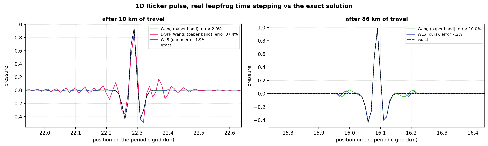
</p>
<p align="center"><sub>Real time stepping vs the exact solution. After 10 km, DOPP's coefficients (pink) ring with 37% error. At the distance where Wang's error reaches 10% (86 km), the waveform-optimized coefficients are at 7.2%.</sub></p>

<p align="center">
  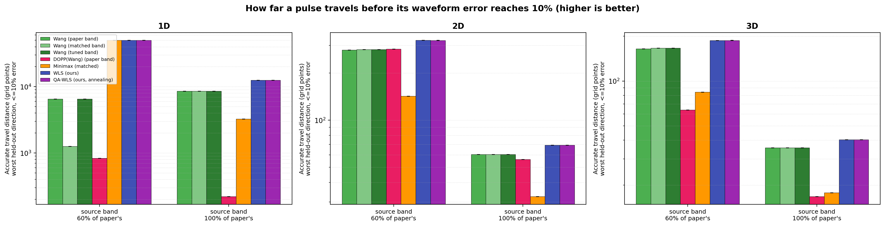
</p>

<details>
<summary>Dispersion error of the designs (held-out directions)</summary>

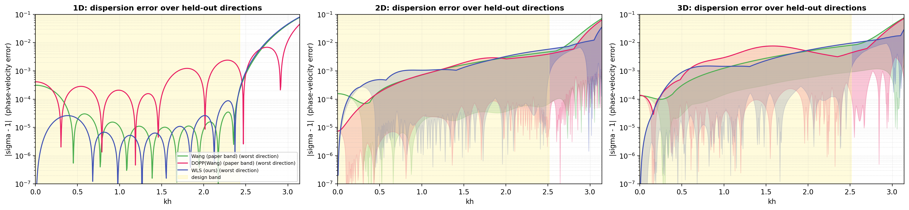

Wang's coefficients (green) are off by 1.3–3.1×10⁻⁴ at the lowest wavenumbers. The waveform-optimized design (blue) is exact there and stays small across the band. DOPP (pink) is 10–100× worse inside the band.

</details>

### V. Wave-propagation checks

FD coefficients from every method were plugged into 1-D and 2-D acoustic simulators: second-order leapfrog in time with a Ricker source. Over the short distances in these figures, every method stays stable and DOPP's wavefields look much like Wang's, both in a homogeneous medium and in a layered model with a high-velocity salt body. These comparisons are visual and use Wang as the reference. The quantitative test against an exact solution is in N5, and it separates the methods clearly.

<p align="center">
  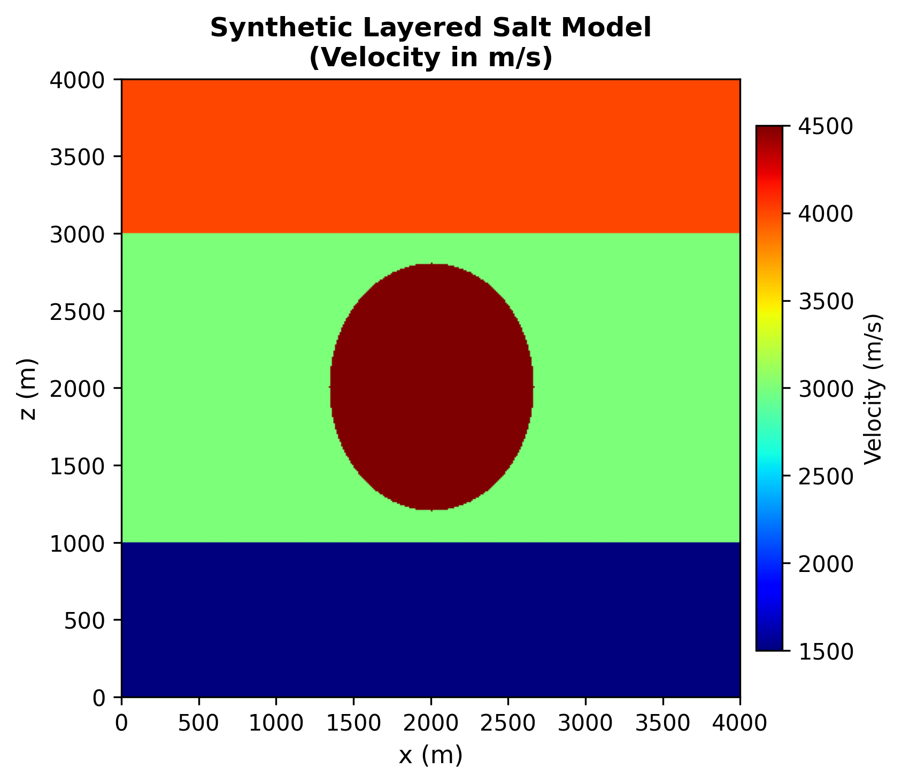
  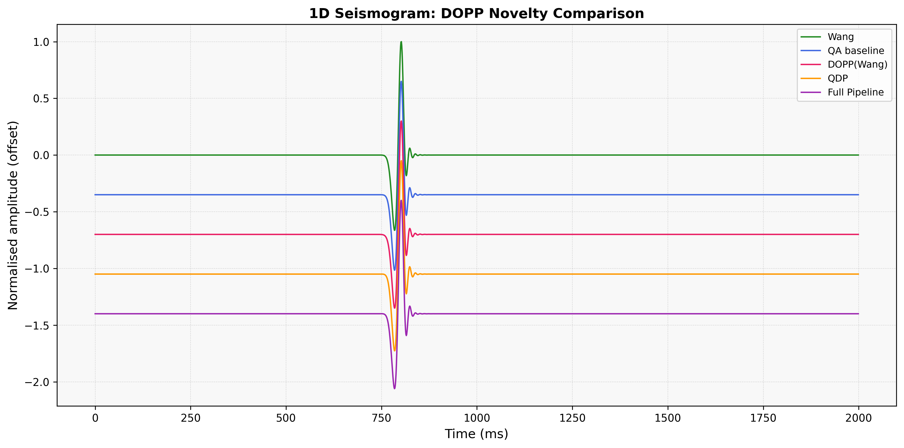
</p>

<details>
<summary>More figures</summary>

| | |
|---|---|
| 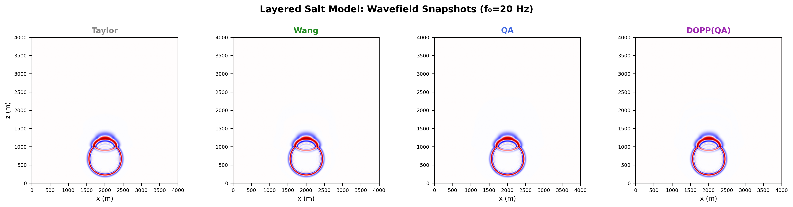 | 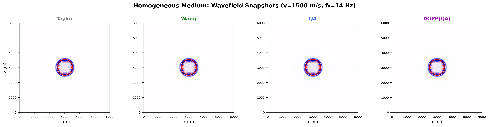 |
| Salt model, one time step, four methods | Homogeneous medium, four methods |
| 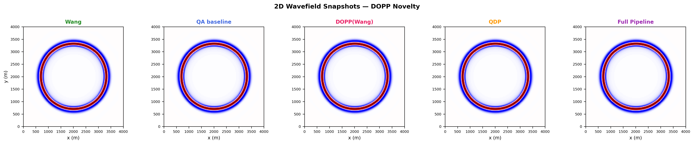 | 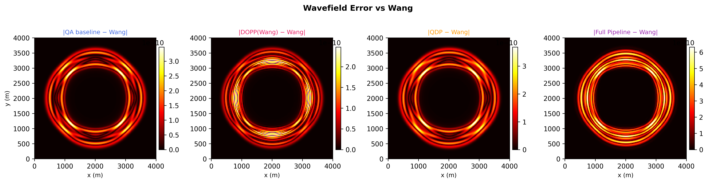 |
| 2-D snapshots for the DOPP variants | Wavefield difference from Wang |
| 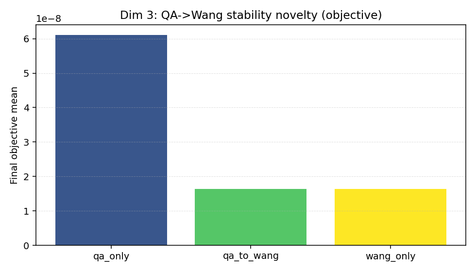 | 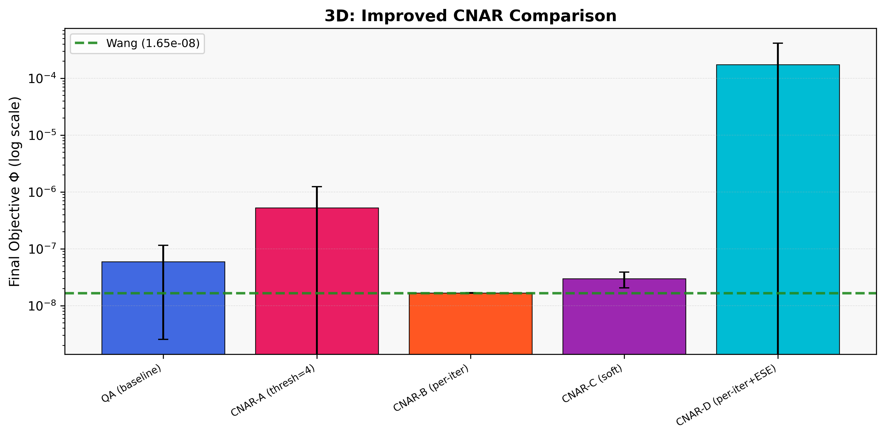 |
| QA → Wang hybrid, 3D | CNAR strategies, 3D |

</details>

## Limitations

- **Classical sampler only.** Every QUBO was solved with simulated annealing. The study tests the *algorithm*, not quantum hardware, and makes no claim about speedup. On SA, a QA run takes about 6–170× longer than Wang's method: 8 s vs 0.05 s in 1D, and 70 s vs 9.5 s in 3D.
- **Small samples, no fixed seeds.** Most statistics use 3–5 runs, and the encoding sweep uses one run per setting. Several of the differences above are within noise, as noted.
- **Confounds.** CNAR changes both the α value and its decay rate (0.7 vs 0.1 per iteration), so its gain is not yet attributable to κ-adaptivity alone.
- **Metric choice.** The DOPP gains are measured in a metric dominated by out-of-band error. See the [N4 caveat](#caveat-where-the-gain-comes-from).
- **Scope of the waveform validation.** The exact waveform-error formula in N5 holds for plane waves in a homogeneous medium, and it is checked against time stepping in 1D. Point sources, heterogeneous models and absorbing boundaries are not tested quantitatively yet. The 2-D wavefield figures in V are visual comparisons.
- **2D/3D gains are modest.** The gains are 11–14% in the worst direction, and they trade worst-direction accuracy for lower-frequency sources (see N5).

## Repository layout

```
├── core/                 Solver library from Wen & Wang (2025), CC BY 4.0. See core/NOTICE.md
│   ├── stagger_FD_coeff.py   linear systems, Φ and σ for 1D/2D/3D staggered grids
│   ├── QUBO_solvers.py       QUBO encoding and iterative sampling solver (+ our ablation options)
│   └── utils.py              Cholesky solver and helpers
├── experiments/          Our experiment scripts (one per study) + experiments_common.py
├── notebooks/            The original Zenodo notebooks, outputs cleared, runnable against core/
├── results/              CSV output of every experiment (raw runs + summaries)
└── figures/              PNG output of every experiment; figures/reproduction/ holds our
                          re-runs of the original notebooks
```

## Getting started

```bash
git clone https://github.com/Samyak336/quantum-annealing-seismic-fd.git
cd quantum-annealing-seismic-fd
python -m venv .venv
.venv\Scripts\activate          # Windows; on macOS/Linux: source .venv/bin/activate
pip install -r requirements.txt

python experiments/Novelty_QA_to_Wang_Stabilization.py   # one study, about 10 minutes
```

Each script writes its CSVs to `results/` and its figures to `figures/`, overwriting the copies in this repository. Scripts can be run from any directory. Tested with Python 3.10. NumPy must stay below 2.0, because the upstream code uses `np.math`.

## Reproducing the results

| Result | Command | Output | Rough runtime* |
|---|---|---|---|
| R. Reproduction | `python experiments/Reproduction_Corrected.py` | `reproduction_corrected.csv`, `repro_corrected_disp_*.png` | 15 min |
| S. Encoding (1D) | `python experiments/Encoding_Sensitivity_Study.py` | `encoding_sensitivity_*.csv`, `encoding_*_vs_R.png` | 10 min |
| S. Encoding (2D/3D), regularization, early hybrid | `python experiments/Multidim_Ablations_and_Novelty.py` | `encoding_sensitivity_dim{2,3}_*`, `regularization_dim*`, `hybrid_dim*`, `multidim_*` | 45 min |
| N1. QA → Wang | `python experiments/Novelty_QA_to_Wang_Stabilization.py` | `novelty_qa_to_wang_*.csv`, `novelty_qaw_*.png` | 10 min |
| N2. CNAR | `python experiments/CNAR_Improved_Study.py` | `cnar_improved_*.csv`, `cnar_improved_*.png` | 30 min |
| N3. ESE | `python experiments/ESE_CNAR_Novelty_Study.py --ese --output-suffix final` | `ese_*_final.csv`, `ese_*_final.png` | 25 min |
| N3. Update rules | `python experiments/Novelty_Ablation_Experiments.py` | `novelty_ablation_*.csv`, `novelty_ablation_*.png` | 2.5 h |
| N4. QDP + DOPP | `python experiments/Dispersion_Optimized_Novelty.py --dim 1 2 3` | `dispersion_novelty_*.csv`, `dispersion_novelty_dim*.png` | 1.5 h |
| N4. In-band vs out-of-band check | `python experiments/Band_Analysis.py` | `band_analysis.csv` | 7 min |
| N5. Waveform-optimized design | `python experiments/Waveform_Optimized_Design.py` | `waveform_design_*.csv`, `waveform_timestep_check.csv`, `waveform_design_*.png` | 20 min |
| V. Forward simulations | `python experiments/Paper_Forward_Simulations.py` | `paper_*.png` | 5 min |
| V. DOPP waveforms | `python experiments/DOPP_Forward_Waveform.py` | `dopp_*.png` | 10 min |

<sub>*Single laptop CPU. Most scripts have a `--quick` flag or `--dim` filter for a faster partial run. Each script's docstring lists its options.</sub>

Other scripts are earlier or exploratory studies:
- `Baseline_Replication.py`: first 1D replication.
- `Hybrid_Classical_Quantum_Study.py`: Wang warm start, then QA (1D).
- `ESE_CNAR_Forward_Simulation.py` and `Waveform_Simulation.py`: dispersion and waveform figures for ESE, CNAR and the hybrid.
- `Novel_QA_Improvements.py` and `Paper_Style_Figures.py`: not used for any result above.

## Credits and license

- The iterative QA method, the analytic step size and the solver library in [`core/`](core) are from **Xixiang Wen and Yanfei Wang**. Paper: [doi:10.1029/2024JH000473](https://doi.org/10.1029/2024JH000473). Code: [doi:10.5281/zenodo.14868887](https://doi.org/10.5281/zenodo.14868887). Their code is licensed CC BY 4.0. The files in `core/` and `notebooks/` stay under that license. [`core/NOTICE.md`](core/NOTICE.md) lists every change we made.
- Everything else (the experiment scripts, results, figures and documentation) is © 2026 Samyak Ajmera and Pratham Patel, released under the [MIT License](LICENSE).
- We thank Prof. Simanchal Padhy (IIT Roorkee) for supervising the project.

## Citation

If you use this repository, please cite it via GitHub's **Cite this repository** button ([`CITATION.cff`](CITATION.cff)). Please also cite the original work:

```bibtex
@article{wen2025seismic,
  title   = {Seismic Wave Propagation Simulation With Quantum Computing},
  author  = {Wen, Xixiang and Wang, Yanfei},
  journal = {Journal of Geophysical Research: Machine Learning and Computation},
  volume  = {2},
  number  = {2},
  pages   = {e2024JH000473},
  year    = {2025},
  doi     = {10.1029/2024JH000473}
}
```
